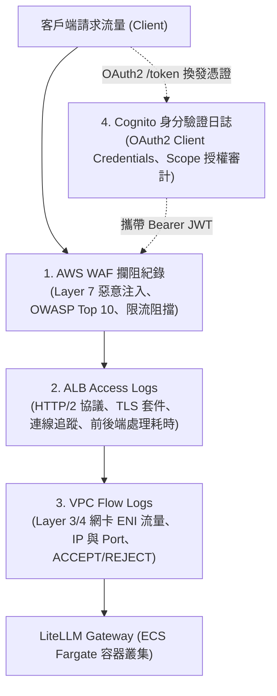
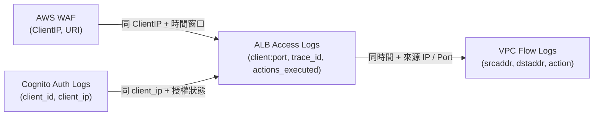

# 網路與邊界防護層 核心軌跡日誌數據字典 (Perimeter Defense Core Logs Data Dictionary)

- **建立日期**：2026-11-12
- **專案名稱**：`terraform-aws-gaia-api-infra-litellm`
- **文件摘要**：彙整 LiteLLM Gateway 於「網路與邊界防護層」收整之四大核心軌跡日誌（VPC Flow Logs、ALB Access Logs、AWS WAF 攔阻紀錄、Cognito 身分驗證日誌）所有維度欄位對應表。格式採精簡直接的「欄位英名稱 : 中文名稱 (範例或說明)」，便於資安與防護監控團隊快速檢視、比對與規則建置。
- **簡報互動卡片 (可切換白底/灰底)**：[perimeter_defense_presentation_cards.html](file:///Users/cfh00800443/gemini/perimeter_defense_presentation_cards.html)

---

## 1. 網路與邊界防護層架構與資料流向

---

## 2. 四大日誌全欄位數據字典 (Direct Key-Value)

> 💡 **顯示樣式**：以下區塊已設定**淺灰底 (`#f6f8fa`)** 與高對比語法著色，即使在深色模式編輯器下預覽也能呈現清爽的淺色卡片效果。若需**純白底 (`#ffffff`)** 或單頁簡報截圖，可開啟 [perimeter_defense_presentation_cards.html](file:///Users/cfh00800443/gemini/perimeter_defense_presentation_cards.html) 切換。

### 2.1 VPC Flow Logs (共 14 欄位)

> 紀錄網卡層級（ENI）的 L3/L4 網路封包元數據，做為內部網路橫向移動與異常 Port 掃描分析依據。

<pre style="background: transparent; border: none; margin: 0; padding: 0; color: #24292e; font-family: ui-monospace, SFMono-Regular, Menlo, Monaco, Consolas, monospace; font-size: 13px; line-height: 1.65; overflow-x: auto;"><code>{
  "version": "Flow Log 版本",
  "account_id": "AWS 帳號 ID",
  "interface_id": "網卡 ENI ID",
  "srcaddr": "來源 IP",
  "dstaddr": "目的 IP",
  "srcport": "來源 Port",
  "dstport": "目的 Port",
  "protocol": "通訊協定編號 (6=TCP, 17=UDP)",
  "packets": "封包數",
  "bytes": "位元組數",
  "start": "採樣起始時間 (Unix Epoch 秒數)",
  "end": "採樣結束時間 (Unix Epoch 秒數)",
  "action": "網路處置動作 (ACCEPT 放行 / REJECT 阻擋)",
  "log_status": "記錄狀態 (OK / NODATA / SKIPDATA)"
}</code></pre>

#### 欄位清單速查表
| 欄位英文名稱 | 中文名稱與說明 |
| :--- | :--- |
| `version` | Flow Log 版本 |
| `account_id` | AWS 帳號 ID |
| `interface_id` | 網卡 ENI ID |
| `srcaddr` | 來源 IP |
| `dstaddr` | 目的 IP |
| `srcport` | 來源 Port |
| `dstport` | 目的 Port |
| `protocol` | 通訊協定編號 (6=TCP, 17=UDP) |
| `packets` | 封包數 |
| `bytes` | 位元組數 |
| `start` | 採樣起始時間 (Unix Epoch 秒數) |
| `end` | 採樣結束時間 (Unix Epoch 秒數) |
| `action` | 網路處置動作 (ACCEPT 放行 / REJECT 阻擋) |
| `log_status` | 記錄狀態 (OK / NODATA / SKIPDATA) |

---

### 2.2 ALB Access Logs (共 36 欄位)

> 紀錄七層負載平衡器的所有 HTTP/HTTPS/WebSocket 請求細節、TLS 加密套件、耗時及 WAF 動作鏈。

<pre style="background: transparent; border: none; margin: 0; padding: 0; color: #24292e; font-family: ui-monospace, SFMono-Regular, Menlo, Monaco, Consolas, monospace; font-size: 13px; line-height: 1.65; overflow-x: auto;"><code>{
  "type": "請求協議類型 (h2 / https / ws)",
  "time": "完成時間戳記 (ISO 8601)",
  "elb": "ALB 資源名稱",
  "client:port": "客戶端來源 IP 與 Port (例: 61.216.89.235:50342)",
  "target:port": "後端容器私網 IP 與 Port (例: 10.42.11.154:4001)",
  "request_processing_time": "ALB 接收處理耗時 (秒)",
  "target_processing_time": "後端容器處理耗時 (秒)",
  "response_processing_time": "ALB 回應傳送耗時 (秒)",
  "elb_status_code": "ALB 回應 HTTP 狀態碼",
  "target_status_code": "後端容器回傳 HTTP 狀態碼",
  "received_bytes": "請求 Payload 大小 (Bytes)",
  "sent_bytes": "回應 Payload 大小 (Bytes)",
  "request": "HTTP 請求行 (例: GET https://... HTTP/2.0)",
  "user_agent": "客戶端軟體特徵",
  "ssl_cipher": "TLS 加密套件 (例: TLS_AES_128_GCM_SHA256)",
  "ssl_protocol": "TLS 協定版本 (例: TLSv1.3)",
  "target_group_arn": "目標群組 ARN",
  "trace_id": "分散式鏈路追蹤 ID (Root=1-...)",
  "domain_name": "SNI 請求網域名稱",
  "chosen_cert_arn": "ACM 憑證 ARN 或連線復用標記",
  "matched_rule_priority": "匹配規則優先級 (0 為預設)",
  "request_creation_time": "請求抵達起始時間 (ISO 8601)",
  "actions_executed": "處置動作鏈 (waf,forward / 僅 waf 為阻擋)",
  "redirect_url": "轉址目標 URL",
  "error_reason": "錯誤原因代碼",
  "target_port_list": "嘗試轉發後端 IP:Port 清單",
  "target_status_code_list": "後端嘗試狀態碼清單",
  "classification": "畸形流量分類代碼",
  "classification_reason": "畸形流量分類原因",
  "conn_trace_id": "底層 TCP/TLS 連線 ID (TID_...)",
  "cert_subject": "mTLS 客戶端憑證主旨",
  "cert_serial_number": "mTLS 憑證序號",
  "cert_issuer_name": "mTLS 簽發 CA",
  "listener_ip": "ALB 監聽器公網實體 IP (例: 52.74.171.228)",
  "tls_named_group": "TLS 密鑰交換群組",
  "client_tls_handshake_time": "TLS 握手耗時 (秒)"
}</code></pre>

#### 欄位清單速查表
| 欄位英文名稱 | 中文名稱與說明 |
| :--- | :--- |
| `type` | 請求協議類型 (h2 / https / ws) |
| `time` | 完成時間戳記 (ISO 8601) |
| `elb` | ALB 資源名稱 |
| `client:port` | 客戶端來源 IP 與 Port (例: 61.216.89.235:50342) |
| `target:port` | 後端容器私網 IP 與 Port (例: 10.42.11.154:4001) |
| `request_processing_time` | ALB 接收處理耗時 (秒) |
| `target_processing_time` | 後端容器處理耗時 (秒) |
| `response_processing_time` | ALB 回應傳送耗時 (秒) |
| `elb_status_code` | ALB 回應 HTTP 狀態碼 |
| `target_status_code` | 後端容器回傳 HTTP 狀態碼 |
| `received_bytes` | 請求 Payload 大小 (Bytes) |
| `sent_bytes` | 回應 Payload 大小 (Bytes) |
| `request` | HTTP 請求行 (例: GET https://... HTTP/2.0) |
| `user_agent` | 客戶端軟體特徵 |
| `ssl_cipher` | TLS 加密套件 (例: TLS_AES_128_GCM_SHA256) |
| `ssl_protocol` | TLS 協定版本 (例: TLSv1.3) |
| `target_group_arn` | 目標群組 ARN |
| `trace_id` | 分散式鏈路追蹤 ID (Root=1-...) |
| `domain_name` | SNI 請求網域名稱 |
| `chosen_cert_arn` | ACM 憑證 ARN 或連線復用標記 |
| `matched_rule_priority` | 匹配規則優先級 (0 為預設) |
| `request_creation_time` | 請求抵達起始時間 (ISO 8601) |
| `actions_executed` | 處置動作鏈 (waf,forward / 僅 waf 為阻擋) |
| `redirect_url` | 轉址目標 URL |
| `error_reason` | 錯誤原因代碼 |
| `target_port_list` | 嘗試轉發後端 IP:Port 清單 |
| `target_status_code_list` | 後端嘗試狀態碼清單 |
| `classification` | 畸形流量分類代碼 |
| `classification_reason` | 畸形流量分類原因 |
| `conn_trace_id` | 底層 TCP/TLS 連線 ID (TID_...) |
| `cert_subject` | mTLS 客戶端憑證主旨 |
| `cert_serial_number` | mTLS 憑證序號 |
| `cert_issuer_name` | mTLS 簽發 CA |
| `listener_ip` | ALB 監聽器公網實體 IP (例: 52.74.171.228) |
| `tls_named_group` | TLS 密鑰交換群組 |
| `client_tls_handshake_time` | TLS 握手耗時 (秒) |

---

### 2.3 AWS WAF 攔阻紀錄 (共 12 欄位)

> 紀錄第七層惡意攻擊（如 SQLi、Log4Shell、已知漏洞特徵、暴力掃描）之阻擋事件與特徵比對結果。

<pre style="background: transparent; border: none; margin: 0; padding: 0; color: #24292e; font-family: ui-monospace, SFMono-Regular, Menlo, Monaco, Consolas, monospace; font-size: 13px; line-height: 1.65; overflow-x: auto;"><code>{
  "Timestamp": "規則匹配時間戳記 (ISO 8601)",
  "ClientIP": "來源 IP",
  "Country": "來源國家代碼 (例: TW, US)",
  "Action": "處置判定 (BLOCK / ALLOW)",
  "RuleName": "命中規則名稱 (例: AWSManagedRulesKnownBadInputsRuleSet)",
  "RuleGroup": "Web ACL 或規則群組名稱",
  "HTTPMethod": "HTTP 請求方法",
  "URI": "請求 URI 路徑",
  "MatchedFilter": "命中攻擊特徵 (例: Log4Shell Pattern)",
  "Headers": "請求標頭抽樣",
  "TerminatingRuleId": "終止規則 ID",
  "WebACLArn": "Web ACL ARN"
}</code></pre>

#### 欄位清單速查表
| 欄位英文名稱 | 中文名稱與說明 |
| :--- | :--- |
| `Timestamp` | 規則匹配時間戳記 (ISO 8601) |
| `ClientIP` | 來源 IP |
| `Country` | 來源國家代碼 (例: TW, US) |
| `Action` | 處置判定 (BLOCK / ALLOW) |
| `RuleName` | 命中規則名稱 (例: AWSManagedRulesKnownBadInputsRuleSet) |
| `RuleGroup` | Web ACL 或規則群組名稱 |
| `HTTPMethod` | HTTP 請求方法 |
| `URI` | 請求 URI 路徑 |
| `MatchedFilter` | 命中攻擊特徵 (例: Log4Shell Pattern) |
| `Headers` | 請求標頭抽樣 |
| `TerminatingRuleId` | 終止規則 ID |
| `WebACLArn` | Web ACL ARN |

---

### 2.4 Cognito 身分驗證日誌 (共 12 欄位)

> 紀錄 LiteLLM 各租戶 Client Credentials 憑證換發、Token 簽發、授權失敗等安全驗證事件。

<pre style="background: transparent; border: none; margin: 0; padding: 0; color: #24292e; font-family: ui-monospace, SFMono-Regular, Menlo, Monaco, Consolas, monospace; font-size: 13px; line-height: 1.65; overflow-x: auto;"><code>{
  "auth_timestamp": "驗證時間戳記 (ISO 8601)",
  "auth_status": "驗證結果 (SUCCESS / FAILED)",
  "client_id": "OAuth2 客戶端識別碼 (例: 4h4j9v9mvmed5a36576e9oergk)",
  "client_name": "App Client 註冊名稱 (例: alan-litellm-test)",
  "mapped_team_id": "映射團隊 ID",
  "client_ip": "認證連線來源 IP",
  "grant_type": "OAuth 授權模式 (client_credentials)",
  "granted_scopes": "核發 Scope 清單 (例: [\"litellm:chat\", \"litellm:models\"])",
  "user_pool_id": "Cognito 使用者集區 ID",
  "token_expiration_sec": "Token 有效秒數",
  "error_code": "失敗代碼 (例: invalid_client, missing_scope)",
  "auth_error_message": "失敗原因說明"
}</code></pre>

#### 欄位清單速查表
| 欄位英文名稱 | 中文名稱與說明 |
| :--- | :--- |
| `auth_timestamp` | 驗證時間戳記 (ISO 8601) |
| `auth_status` | 驗證結果 (SUCCESS / FAILED) |
| `client_id` | OAuth2 客戶端識別碼 (例: 4h4j9v9mvmed5a36576e9oergk) |
| `client_name` | App Client 註冊名稱 (例: alan-litellm-test) |
| `mapped_team_id` | 映射團隊 ID |
| `client_ip` | 認證連線來源 IP |
| `grant_type` | OAuth 授權模式 (client_credentials) |
| `granted_scopes` | 核發 Scope 清單 (例: ["litellm:chat", "litellm:models"]) |
| `user_pool_id` | Cognito 使用者集區 ID |
| `token_expiration_sec` | Token 有效秒數 |
| `error_code` | 失敗代碼 (例: invalid_client, missing_scope) |
| `auth_error_message` | 失敗原因說明 |

---

## 3. 關聯分析鏈路 (Correlation Architecture)

在發生異常或攻擊事件時，四張表可透過以下核心維度進行快速聯防溯源：

- **外部攻擊關聯**：`WAF.ClientIP` $\rightarrow$ `ALB.client:port` $\rightarrow$ `ALB.actions_executed`（確認是否僅為 `waf` 攔阻，或有 `forward` 至後端）。
- **身分濫用關聯**：`Cognito.client_id` + `Cognito.client_ip` $\rightarrow$ `ALB.client:port` $\rightarrow$ 確認異常憑證呼叫的 API 軌跡。
- **網路繞過關聯**：`VPC.srcaddr` + `VPC.dstport` $\rightarrow$ 確認是否有繞過 ALB 直接探測 ECS/私網網卡的連線嘗試（預期為 `REJECT`）。
